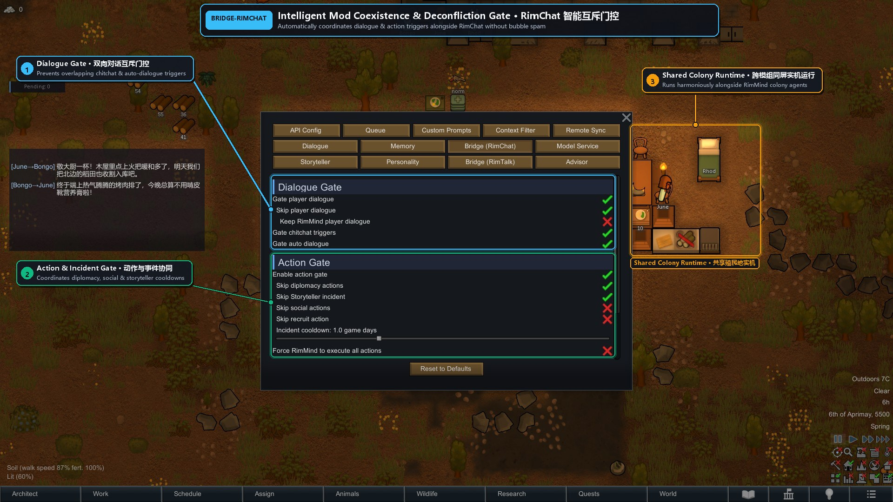
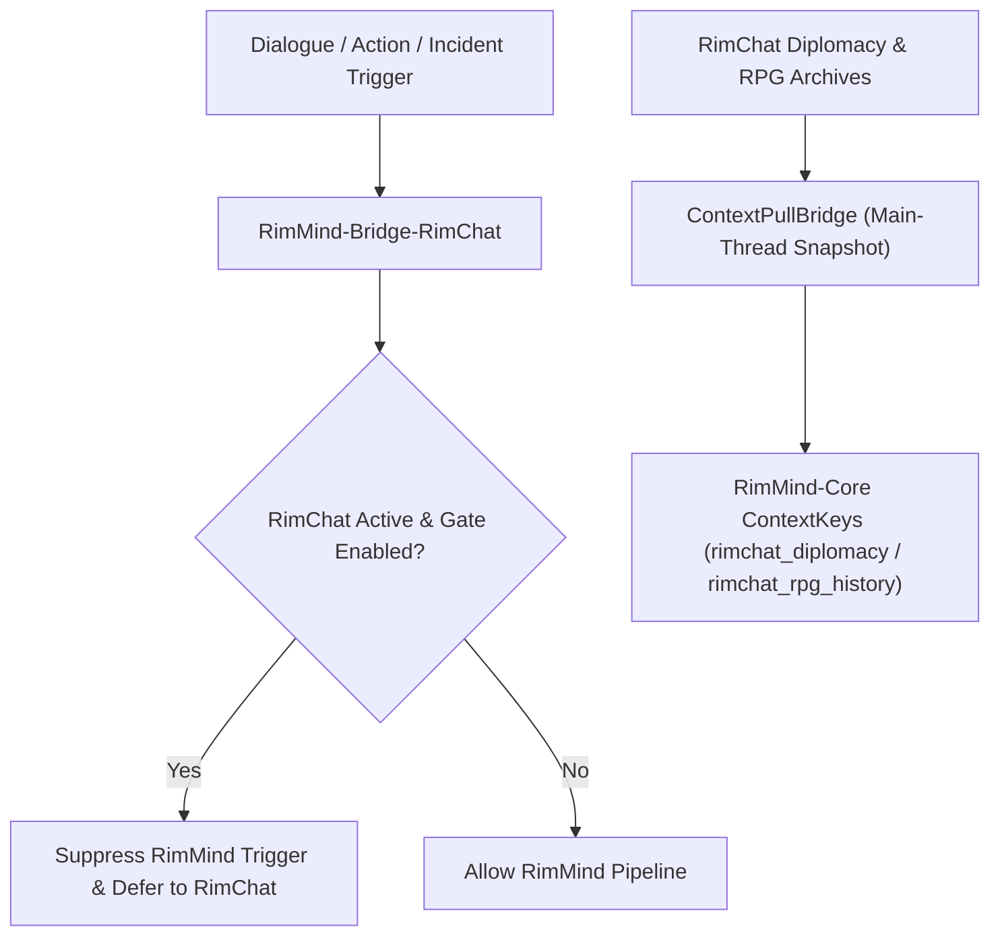

<div align="center">

# RimMind-Bridge-RimChat 🌉
### Mutual Exclusion Gating & History Pull Bridge for RimWorld 1.6 & 1.7

**English** | [简体中文](README_zh.md)

<p>
  <a href="https://rimworldgame.com/"></a>
  <a href="https://github.com/RimWorld-RimMind-Mod/RimWorld-RimMind-Mod-Core"></a>
  <a href="#"></a>
  <a href="LICENSE"></a>
</p>

<p><em>Enables seamless coexistence with RimChat through dialogue/action gating, shared storyteller cooldowns, and one-way context pull.</em></p>

</div>

---

## 📖 Overview

**RimMind-Bridge-RimChat** provides configurable mutual-exclusion gating, shared storyteller cooldown coordination, and one-way history pull when playing with both **RimMind** and the third-party **RimChat** mod. It prevents duplicate chat windows and overlapping diplomacy/social/recruitment actions, and imports recent RimChat diplomacy and RPG logs into RimMind's context engine.

### Key Capabilities
- **Dialogue Gating**: Independently gates RimMind's chitchat, auto dialogue, player input, and "Chat with X" float-menu triggers when RimChat is active, with an optional override to keep both player chat entries.
- **Action & Storyteller Gating**: Classifies diplomacy, social/romance, and recruitment tools via `ToolManifest` metadata (with explicit fallbacks) and coordinates storyteller incident triggers through a save-persisted shared cooldown (default 60,000 ticks / 1 in-game day).
- **One-Way Context Pull (RimChat → RimMind)**: Safely reads RimChat's diplomacy sessions (`rimchat_diplomacy`) and optional per-colonist RPG archive (`rimchat_rpg_history`) via main-thread snapshots and cached reflection, automatically circuit-breaking on schema mismatch.

---

## 🎮 In-Game Showcase


*Harmonious coexistence in action: RimMind and RimChat active in the same colony without duplicate dialogue triggers or conflicting diplomacy actions.*

---

## 🏛️ Gating & Context Pull Architecture



---

## 🛠️ Installation & Load Order

```text
1. Harmony
2. Core (Vanilla RimWorld)
3. RimChat (Required third-party mod)
4. RimMind-Core
5. RimMind-Bridge-RimChat
```

---

## 🧪 Developer Guide & Testing

Run unit tests and dual-version builds from the workspace root:

```powershell
dotnet test RimMind-Bridge-RimChat/Tests/RimMindBridgeRimChat.Tests.csproj -c Release
dotnet build RimMind-Bridge-RimChat/Source/RimMindBridgeRimChat.csproj -c Release -p:GameVersion=1.6
dotnet build RimMind-Bridge-RimChat/Source/RimMindBridgeRimChat.csproj -c Release -p:GameVersion=1.7
```

---

## 📜 License

Licensed under the [MIT License](LICENSE).
