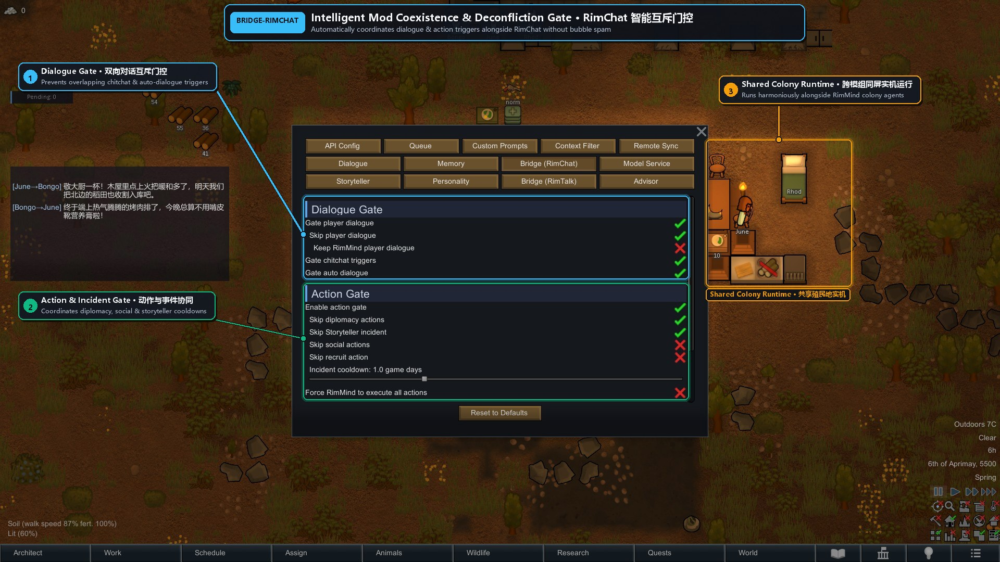
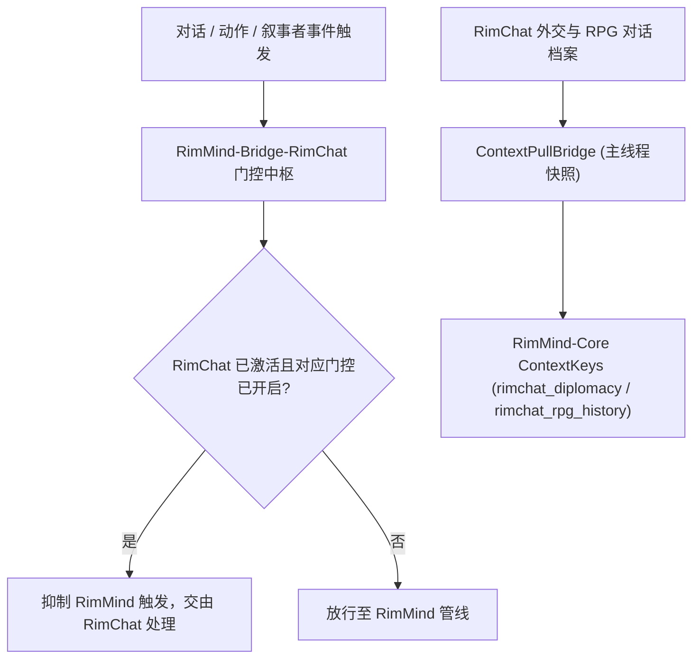

<div align="center">

# RimMind-Bridge-RimChat 🌉
### 专为 RimWorld 1.6 & 1.7 打造的 RimChat 门控互斥、共享冷却与历史拉取桥

[English](README.md) | **简体中文**

<p>
  <a href="https://rimworldgame.com/"></a>
  <a href="https://github.com/RimWorld-RimMind-Mod/RimWorld-RimMind-Mod-Core"></a>
  <a href="#"></a>
  <a href="LICENSE"></a>
</p>

<p><em>通过对话/动作门控、叙事者共享冷却与单向上下文拉取，实现与 RimChat 的无缝共存。</em></p>

</div>

---

## 📖 模块概览

**RimMind-Bridge-RimChat** 为同时使用 **RimMind** 与第三方模组 **RimChat** 的玩家提供可精细配置的门控互斥、叙事者共享冷却与单向上下文拉取。它能够防止重复对话入口与外交/社交/招募动作撞车，并将 RimChat 的外交与 RPG 对话历史安全拉取到 RimMind 上下文引擎中。

### 核心特性
- **对话门控互斥**：在 RimChat 激活时分别控制闲聊、自动对话、玩家对话及“与 X 对话”浮动菜单的抑制策略，支持强制保留双入口共存。
- **动作与叙事者门控**：基于 `ToolManifest` 元数据（辅以显式兜底）对外交、社交/恋爱及招募类工具分类门控，并通过存档持久化的共享冷却（默认 60,000 ticks / 1 游戏天）协调叙事者事件。
- **单向上下文拉取（RimChat → RimMind）**：经由主线程快照与缓存反射安全读取 RimChat 的外交会话（`rimchat_diplomacy`）及可选的小人 RPG 历史（`rimchat_rpg_history`），结构不兼容时自动熔断并单次告警。

---

## 🎮 实机特性展示


*双模组协同实机展示：RimMind 与 RimChat 同时加载运行，界面清爽无冲突，对话与外交动作协调触发。*

---

## 🏛️ 门控与上下文拉取架构



---

## 🛠️ 安装与加载顺序

```text
1. Harmony
2. Core (RimWorld 原版)
3. RimChat (前置第三方模组)
4. RimMind-Core
5. RimMind-Bridge-RimChat
```

---

## 🧪 开发者测试指南

从工作区根目录运行单元测试与双版本构建：

```powershell
dotnet test RimMind-Bridge-RimChat/Tests/RimMindBridgeRimChat.Tests.csproj -c Release
dotnet build RimMind-Bridge-RimChat/Source/RimMindBridgeRimChat.csproj -c Release -p:GameVersion=1.6
dotnet build RimMind-Bridge-RimChat/Source/RimMindBridgeRimChat.csproj -c Release -p:GameVersion=1.7
```

---

## 📜 开源协议

本项目采用 [MIT License](LICENSE) 开源许可证。
